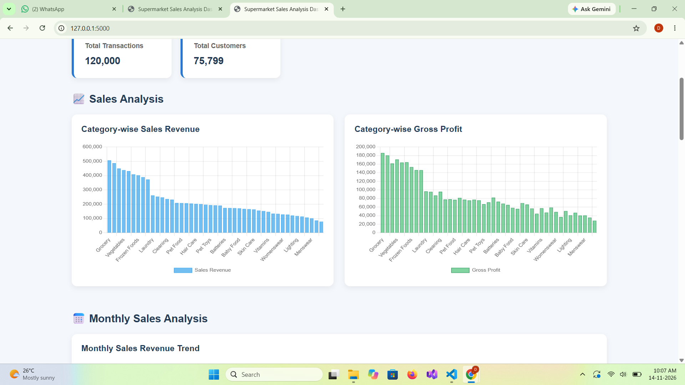
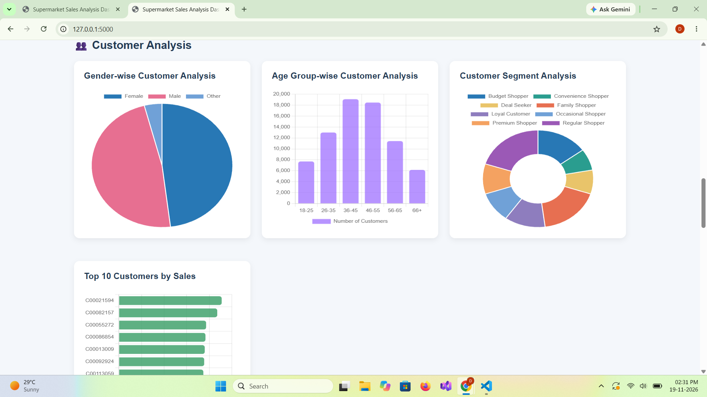

# 🛒 Supermarket Sales Analysis Dashboard

**Sales Performance | Profit Analysis | Customer Insights**

## 📌 Project Overview

The Supermarket Sales Analysis Dashboard is a Data Analyst project developed using Python, Pandas, Flask, HTML, CSS, JavaScript, and Chart.js.

This project analyzes supermarket sales data to understand business performance, product category performance, profitability, and customer purchasing behavior.

The results are presented through an interactive web dashboard containing summary cards, charts, and key business insights.

## 🎯 Project Objectives

- Analyze supermarket sales data.
- Calculate total sales revenue and gross profit.
- Identify total orders and transactions.
- Analyze category-wise sales and profit.
- Understand monthly sales trends.
- Analyze customer demographics and purchasing behavior.
- Identify top-selling products and customers.
- Present meaningful business insights.

## 📊 Dataset

- Dataset Source: Kaggle
- Dataset File: supermarket_large_dataset.csv
- File Format: CSV

Dataset Link:
https://www.kaggle.com/datasets/datascikhan/supermarket

Note: Dataset files are excluded from this repository because of their large file sizes. Download the dataset and place the required CSV files in the project directory.

## 🛠️ Technologies Used

| Technology | Purpose |
|---|---|
| Python | Programming |
| Pandas | Data Cleaning and Analysis |
| NumPy | Numerical Operations |
| Flask | Web Application |
| Matplotlib | Data Visualization |
| Seaborn | Statistical Visualization |
| HTML | Dashboard Structure |
| CSS | Dashboard Styling |
| JavaScript | Interactive Functionality |
| Chart.js | Interactive Charts |

## ✨ Dashboard Features

### 1. Sales Overview

The dashboard displays important business metrics:

| Metric | Result |
|---|---:|
| Total Sales Revenue | ₹9,995,644.58 |
| Total Gross Profit | ₹3,770,441.83 |
| Total Orders | 45,500 |
| Profit Margin | 37.72% |
| Total Units Sold | 1,021,188 |
| Total Transactions | 120,000 |
| Total Customers | 75,799 |
| Average Order Value | ₹219.68 |

### 2. Sales & Profit Analysis

- Category-wise Sales Revenue
- Category-wise Gross Profit

### 3. Monthly Sales Analysis

- Monthly Sales Revenue Trend

### 4. Product Analysis

- Top 10 Products by Sales
- Product-wise Sales Performance

### 5. Customer Analysis

- Gender-wise Customer Analysis
- Age Group-wise Customer Analysis
- Customer Segment Analysis
- Top 10 Customers by Sales

## 📈 Key Business Insights

- Total Sales Revenue: ₹9,995,644.58
- Total Gross Profit: ₹3,770,441.83
- Total Orders: 45,500
- Total Customers: 75,799
- Profit Margin: 37.72%
- Top Sales Category: Grocery – ₹506,229.87
- Highest Spending Customer: C00021594 – ₹2,274.72
- Top Selling Product: Product_3015 – ₹26,182.43

These insights help understand sales performance, product contribution, and customer purchasing behavior.

## 📂 Project Structure

```text
Supermarket-Sales-Analysis/
│
├── app.py
├── data_cleaning.py
├── sales_analysis.py
├── sales_summary.csv
├── requirements.txt
├── README.md
├── .gitignore
│
├── templates/
│   └── index.html
│
├── static/
│   ├── category_sales_chart.png
│   ├── monthly_sales_chart.png
│   ├── profit_chart.png
│   ├── sales_revenue_chart.png
│   └── top_products_chart.png
│
└── screenshots/
    ├── dashboard_overview.png
    ├── sales_analysis.png
    ├── monthly_sales.png
    ├── product_analysis.png
    ├── customer_analysis.png
    └── key_insights.png
```


**Note:** Large dataset CSV files are stored locally and excluded from GitHub using `.gitignore`.

## ⚙️ Installation and Setup

### Step 1: Install Python

Install Python 3 on your computer.

### Step 2: Clone the Repository

```bash
git clone https://github.com/dharshu33666-debug/Supermarket-Sales-Analysis-Dashboard.git

cd Supermarket-Sales-Analysis-Dashboard


```

```

### Step 3: Create a Virtual Environment

```bash
python -m venv venv
```

Activate the virtual environment on Windows:

```bash
venv\Scripts\activate
```

### Step 4: Install Required Libraries

```bash
pip install -r requirements.txt
```

### Step 5: Download the Dataset

Download the dataset from:

[Supermarket Dataset – Kaggle](https://www.kaggle.com/datasets/datascikhan/supermarket)

Place the required CSV files in the project directory:

- `supermarket_large_dataset.csv`
- `supermarket_cleaned_dataset.csv`

Use the filenames expected by the application and data processing scripts.

### Step 6: Run the Application

```bash
python app.py
```

### Step 7: Open the Dashboard

Open your browser and visit:

```text
http://127.0.0.1:5000
```

## 📊 Data Analysis Process

1. Import the supermarket dataset using Pandas.
2. Inspect the dataset and understand its structure.
3. Clean and prepare the data.
4. Calculate total sales revenue and gross profit.
5. Analyze orders, transactions, and customers.
6. Perform category-wise sales and profit analysis.
7. Analyze monthly sales trends.
8. Perform customer demographic analysis.
9. Identify top customers by sales.
10. Generate charts and business insights.
11. Present the results through a Flask dashboard.

## 💡 Project Benefits

- Helps understand supermarket business performance.
- Identifies profitable product categories.
- Provides insights into customer purchasing behavior.
- Makes sales and profit information easier to understand.
- Presents multiple business metrics in one dashboard.
- Demonstrates practical data analysis and visualization skills.

## 🎓 Skills Demonstrated

- Python Programming
- Data Cleaning
- Data Analysis
- Exploratory Data Analysis (EDA)
- Pandas
- Data Visualization
- Customer Analysis
- Sales and Profit Analysis
- Flask Web Development
- HTML and CSS
- JavaScript
- Chart.js
- Git and GitHub

## 🚀 Future Enhancements

- Add interactive date filters.
- Include advanced customer segmentation.
- Add product performance comparisons.
- Introduce sales forecasting.
- Add downloadable reports.
- Improve dashboard responsiveness.
- Deploy the application online.

## 🏁 Conclusion

The **Supermarket Sales Analysis Dashboard** demonstrates how Python, Pandas, and visualization tools can be used to analyze supermarket data and generate meaningful business insights.

The project combines sales performance analysis, profit analysis, and customer insights in an interactive dashboard. It provides practical experience in data analytics, data visualization, and web-based dashboard development.

## 👩‍💻 Author

Developed as a **Supermarket Sales Analysis – Data Analyst Project**.

**GitHub Repository:**  
git clone https://github.com/dharshu33666-debug/Supermarket-Sales-Analysis-Dashboard.git

cd Supermarket-Sales-Analysis-Dashboard
**Dataset Source:**  
https://www.kaggle.com/datasets/datascikhan/supermarket

Dashboard Screenshots

### 1. Dashboard Overview


### 2. Sales Analysis


### 3. Monthly Sales Analysis


### 4. Product Analysis


### 5. Customer Analysis


### 6. Key Business Insights


