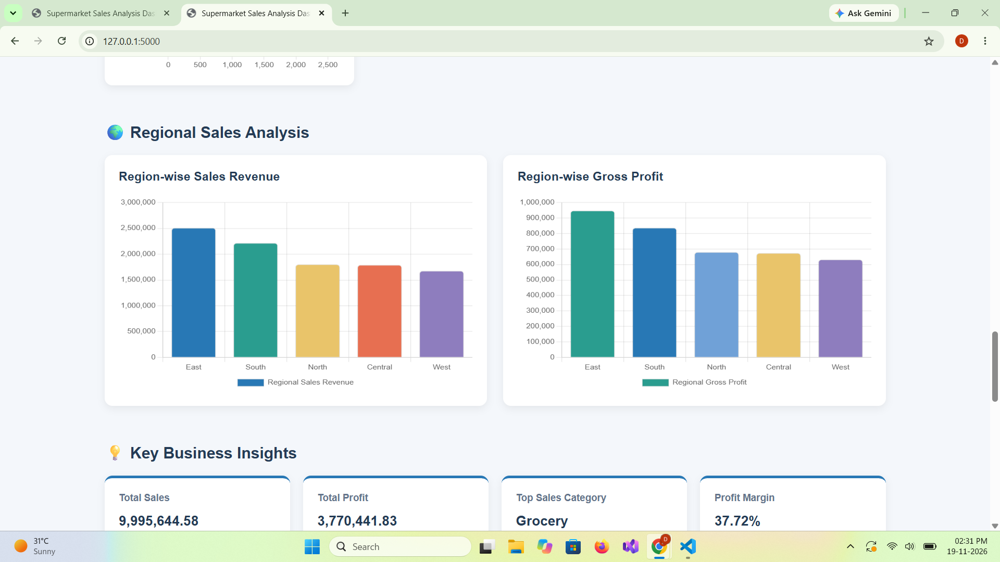
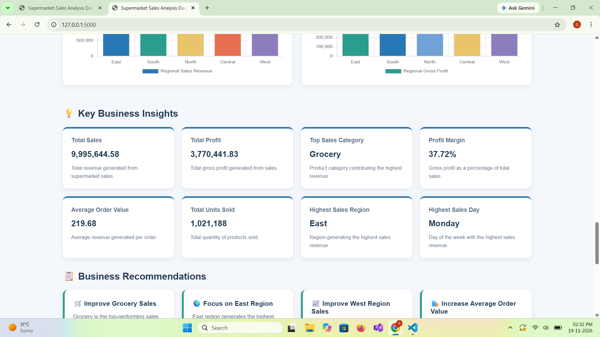

# 🛒 Supermarket Sales Analysis Dashboard

**Sales Performance | Profit Analysis | Customer Insights | Business Recommendations**

## 📌 Project Overview

The **Supermarket Sales Analysis Dashboard** is a Data Analyst project developed using Python, Pandas, Flask, HTML, CSS, JavaScript, and Chart.js.

This project analyzes supermarket sales data to understand business performance, product category performance, profitability, regional performance, and customer purchasing behavior.

The results are presented through an interactive web dashboard containing summary cards, charts, key business insights, and business recommendations.

## 🎯 Project Objectives

- Analyze supermarket sales data.
- Calculate total sales revenue and gross profit.
- Identify total orders and transactions.
- Analyze category-wise sales and profit.
- Understand monthly sales trends.
- Analyze customer demographics and purchasing behavior.
- Identify top-selling products and customers.
- Compare sales and profit across different regions.
- Generate meaningful business insights and recommendations.

## 📊 Dataset

- **Dataset Source:** Kaggle
- **Dataset File:** `supermarket_large_dataset.csv`
- **File Format:** CSV

**Dataset Link:**  
https://www.kaggle.com/datasets/datascikhan/supermarket

**Note:** Dataset files are excluded from this repository because of their large file sizes. Download the dataset and place the required CSV files in the project directory.

## 🛠️ Technologies Used

| Technology | Purpose |
|---|---|
| Python | Programming |
| Pandas | Data Cleaning and Analysis |
| NumPy | Numerical Operations |
| Flask | Web Application |
| Matplotlib | Data Visualization |
| Seaborn | Statistical Visualization |
| HTML | Dashboard Structure |
| CSS | Dashboard Styling |
| JavaScript | Interactive Functionality |
| Chart.js | Interactive Charts |
| Git & GitHub | Version Control |

## ✨ Dashboard Features

### 1. Sales Overview

| Metric | Result |
|---|---:|
| Total Sales Revenue | ₹9,995,644.58 |
| Total Gross Profit | ₹3,770,441.83 |
| Total Orders | 45,500 |
| Profit Margin | 37.72% |
| Total Units Sold | 1,021,188 |
| Total Transactions | 120,000 |
| Total Customers | 75,799 |
| Average Order Value | ₹219.68 |

### 2. Sales & Profit Analysis

- Category-wise Sales Revenue
- Category-wise Gross Profit

### 3. Monthly Sales Analysis

- Monthly Sales Revenue Trend
- Monthly performance from January 2023 to December 2024

### 4. Product Analysis

- Top 10 Products by Sales
- Product-wise Sales Performance

### 5. Customer Analysis

- Gender-wise Customer Analysis
- Age Group-wise Customer Analysis
- Customer Segment Analysis
- Top 10 Customers by Sales

### 6. Regional Sales Analysis

- Region-wise Sales Revenue
- Region-wise Gross Profit
- Comparison of performance across five regions

### 7. Key Business Insights

The dashboard highlights important findings from supermarket sales, profitability, product performance, customer behavior, and regional performance.

### 8. Business Recommendations

The dashboard provides practical suggestions to improve sales, inventory management, customer engagement, and profitability.

## 💡 Key Business Insights

### 1. Sales & Profitability Analysis

- Total Sales Revenue: ₹9,995,644.58
- Total Gross Profit: ₹3,770,441.83
- Overall Profit Margin: 37.72%
- The business generated a gross profit margin of 37.72%, indicating positive overall profitability.

### 2. Category Performance Analysis

- Grocery recorded the highest sales revenue of ₹506,229.87.
- Grocery also achieved the highest gross profit among the categories shown in the dashboard.
- This highlights Grocery as a major contributor to supermarket performance.

### 3. Product Performance Analysis

- Product_3015 was identified as the top-selling product.
- Generated total sales revenue of ₹26,182.43.
- Identifying top-performing products can help improve inventory and sales strategies.

### 4. Customer Behavior Analysis

- Customer C00021594 recorded the highest spending of ₹2,274.72.
- The 36–45 age group represented the largest customer segment by count.
- Customer segmentation helps understand purchasing patterns and improve marketing strategies.

### 5. Monthly Sales Trend Analysis

- Analyzed monthly sales performance from January 2023 to December 2024.
- Observed relatively stable sales revenue with month-to-month fluctuations.
- Monthly trend analysis helps monitor business performance over time.

### 6. Regional Sales Analysis

- East region recorded the highest sales revenue of ₹2,509,079.94.
- South region recorded sales revenue of ₹2,216,224.74.
- North region recorded sales revenue of ₹1,801,723.84.
- Central region recorded sales revenue of ₹1,791,990.77.
- West region recorded the lowest sales revenue of ₹1,676,625.29.
- East is the leading region, while West has an opportunity for improvement.

### 📌 Key Takeaway

The analysis highlights overall profitability, strong Grocery category performance, top-selling products, customer purchasing patterns, and regional sales differences.

## 📋 Business Recommendations

### 1. Improve Grocery Sales

Grocery is the top-performing sales category. Maintain sufficient stock, improve product availability, and introduce attractive grocery offers.

**Priority:** High

### 2. Focus on East Region

East region generates the highest sales revenue. Continue successful sales strategies and maintain customer satisfaction in this region.

**Priority:** High

### 3. Improve West Region Sales

West region has the lowest sales revenue among the five regions. Study customer demand and improve product availability and promotions.

**Priority:** Medium

### 4. Increase Average Order Value

The current Average Order Value is ₹219.68. Introduce combo offers, discounts, and cross-selling strategies to encourage larger purchases.

**Priority:** Medium

### 5. Maintain Profit Margin

The current Profit Margin is 37.72%. Monitor operating costs, manage inventory efficiently, and maintain profitable pricing strategies.

**Priority:** High

## 📂 Project Structure

```text
Supermarket-Sales-Analysis-Dashboard/
│
├── app.py
├── data_cleaning.py
├── sales_analysis.py
├── sales_summary.csv
├── requirements.txt
├── README.md
├── .gitignore
│
├── templates/
│   └── index.html
│
├── static/
│   ├── category_sales_chart.png
│   ├── monthly_sales_chart.png
│   ├── profit_chart.png
│   ├── sales_revenue_chart.png
│   └── top_products_chart.png
│
└── screenshots/
    ├── dashboard_overview.png
    ├── sales_analysis.png
    ├── monthly_sales.png
    ├── product_analysis.png
    ├── customer_analysis.png
    ├── regional_analysis.png
    ├── business_insights.png
    └── business_recommendations.png
```

**Note:** Keep only filenames that actually exist in your project folder. Large dataset CSV files are stored locally and excluded from GitHub using `.gitignore`.

## ⚙️ Installation and Setup

### Step 1: Install Python

Install Python 3 on your computer.

### Step 2: Clone the Repository

```bash
git clone https://github.com/dharshu33666-debug/Supermarket-Sales-Analysis-Dashboard.git

cd Supermarket-Sales-Analysis-Dashboard
```

### Step 3: Create a Virtual Environment

```bash
python -m venv venv
```

Activate the virtual environment on Windows:

```bash
venv\Scripts\activate
```

### Step 4: Install Required Libraries

```bash
pip install -r requirements.txt
```

### Step 5: Download the Dataset

Download the dataset from:

[Supermarket Dataset – Kaggle](https://www.kaggle.com/datasets/datascikhan/supermarket)

Place the required CSV files in the project directory:

- `supermarket_large_dataset.csv`
- `supermarket_cleaned_dataset.csv`

Use the filenames expected by the application and data processing scripts.

### Step 6: Run the Application

```bash
python app.py
```

### Step 7: Open the Dashboard

Open your browser and visit:

```text
http://127.0.0.1:5000
```

## 📊 Data Analysis Process

1. Import the supermarket dataset using Pandas.
2. Inspect the dataset and understand its structure.
3. Clean and prepare the data.
4. Calculate total sales revenue and gross profit.
5. Analyze orders, transactions, and customers.
6. Perform category-wise sales and profit analysis.
7. Analyze monthly sales trends.
8. Perform customer demographic analysis.
9. Identify top customers by sales.
10. Compare region-wise sales and gross profit.
11. Generate charts and business insights.
12. Prepare business recommendations.
13. Present the results through a Flask dashboard.

## 📸 Dashboard Screenshots

### 1. Dashboard Overview


### 2. Sales Analysis


### 3. Monthly Sales Analysis


### 4. Product Analysis


### 5. Customer Analysis


### 6. Regional Sales Analysis



### 7. Key Business Insights

### 7. Key Business Insights



### 8. Business Recommendations


## 🎓 Skills Demonstrated

- Python Programming
- Data Cleaning
- Data Analysis
- Exploratory Data Analysis (EDA)
- Pandas
- NumPy
- Data Visualization
- Customer Analysis
- Sales and Profit Analysis
- Regional Analysis
- Flask Web Development
- HTML and CSS
- JavaScript
- Chart.js
- Git and GitHub

## 🚀 Future Enhancements

- Add interactive date filters.
- Include advanced customer segmentation.
- Add product performance comparisons.
- Introduce sales forecasting.
- Add downloadable reports.
- Improve dashboard responsiveness.
- Deploy the application online.

## 🏁 Conclusion

The **Supermarket Sales Analysis Dashboard** demonstrates how Python, Pandas, and visualization tools can be used to analyze supermarket data and generate meaningful business insights.

The project combines sales performance analysis, profit analysis, customer insights, regional comparisons, and business recommendations in an interactive dashboard.

It provides practical experience in data analytics, data visualization, and web-based dashboard development.

## 👩‍💻 Author

Developed as a **Supermarket Sales Analysis – Data Analyst Project**.

**GitHub Repository:**  
https://github.com/dharshu33666-debug/Supermarket-Sales-Analysis-Dashboard

**Dataset Source:**  
https://www.kaggle.com/datasets/datascikhan/supermarket
